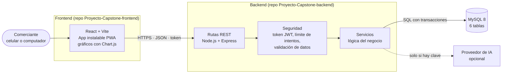
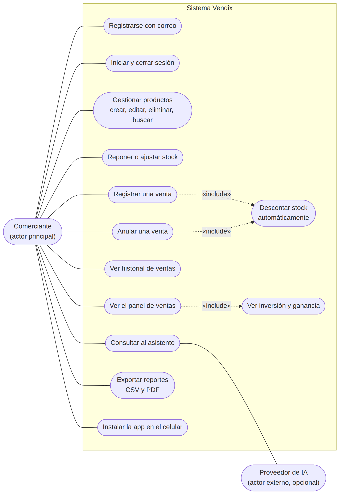
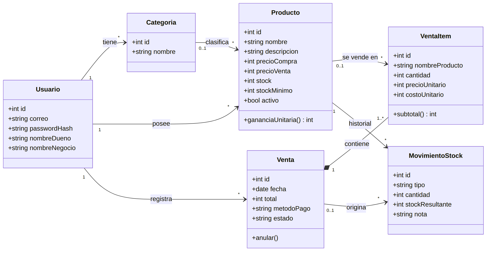
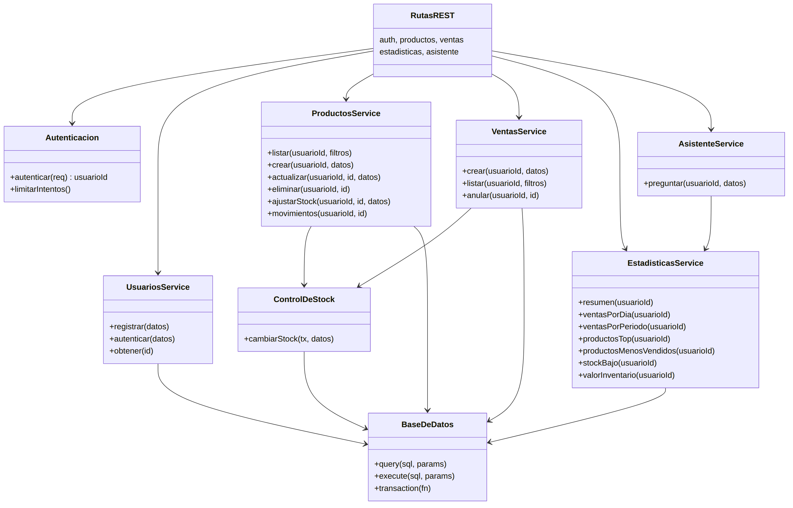
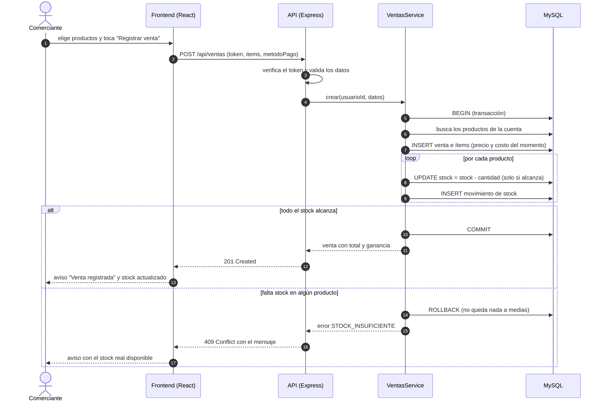
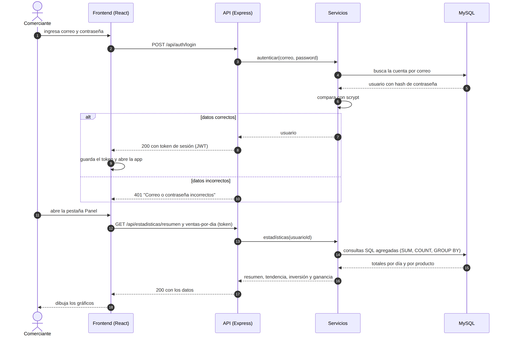
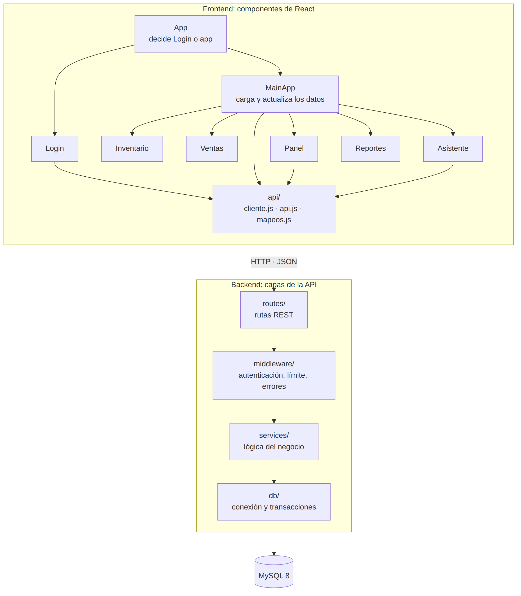
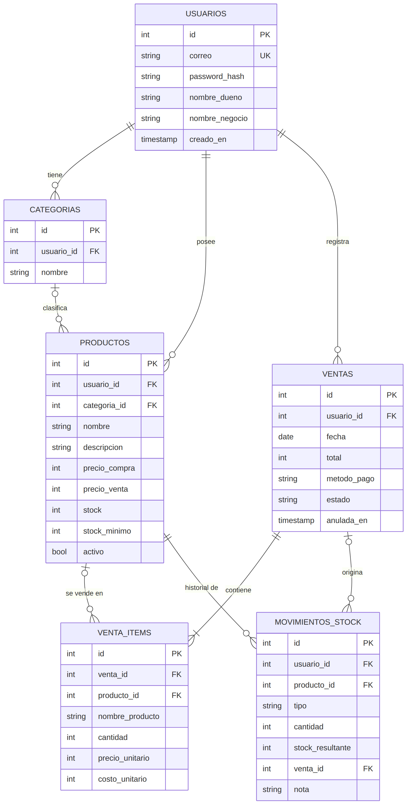

# Diagramas UML y de arquitectura — Vendix

**Versión 2.0 · Actualizado: noviembre de 2026**

Los diagramas de este documento representan el sistema **tal como está implementado** (frontend en React, API en Node/Express
y base de datos MySQL). Los archivos fuente (Mermaid, texto editable) están en `img/*.mmd`; las imágenes se regeneran con
`mmdc -i archivo.mmd -o archivo.png`.

| Diagrama | Tipo | Imagen |
|---|---|---|
| Arquitectura del sistema | Arquitectura | `img/arquitectura.png` |
| Casos de uso | UML — casos de uso | `img/casos_de_uso.png` |
| Clases del dominio | UML — clases | `img/clases_dominio.png` |
| Clases de servicios (capas del backend) | UML — clases | `img/clases_servicios.png` |
| Registrar una venta | UML — secuencia | `img/secuencia_venta.png` |
| Iniciar sesión y consultar el panel | UML — secuencia | `img/secuencia_login_panel.png` |
| Componentes | UML — componentes | `img/componentes.png` |
| Modelo entidad-relación | Base de datos | `img/er.png` |

## 1. Arquitectura del sistema

El comerciante usa la app (React, instalable en el celular). La app habla con la API REST por HTTPS enviando un token de sesión.
La API valida y aplica las reglas del negocio y guarda todo en MySQL. Si hay una clave configurada, el asistente consulta a un proveedor de IA.

## 2. Casos de uso

El comerciante es el actor principal. Registrar y anular una venta *incluyen* el descuento (o devolución) automático de stock;
el panel *incluye* la inversión y la ganancia. El proveedor de IA es un actor externo opcional del asistente.

## 3. Diagrama de clases del dominio

Una cuenta (**Usuario**) tiene categorías, productos y ventas. Una **Venta** contiene uno o más **VentaItem**, que guardan el nombre,
el precio y el costo del momento. Cada cambio de stock queda en **MovimientoStock**.

## 4. Diagrama de clases de servicios (capas del backend)

Las rutas REST llaman a los servicios (lógica del negocio); los servicios usan una única pieza de control de stock y la capa de base de datos
(consultas y transacciones). Esta separación permite probar la lógica sin levantar el servidor.

## 5. Diagrama de secuencia: registrar una venta

Todo ocurre dentro de una transacción: si algún producto no tiene stock suficiente, se deshace la venta completa y la app muestra el stock real.

## 6. Diagrama de secuencia: iniciar sesión y consultar el panel

## 7. Diagrama de componentes

En el frontend, `App` decide entre `Login` y `MainApp`; `MainApp` carga los datos y los reparte a las cinco pantallas, y todas hablan
con el servidor a través de la carpeta `api/`. En el backend, una petición atraviesa rutas, seguridad, servicios y base de datos.

## 8. Modelo entidad-relación

Detalle de cada tabla y de las decisiones de diseño: `Codigo/docs/MODELO_DE_DATOS.md` en el repositorio del backend.
