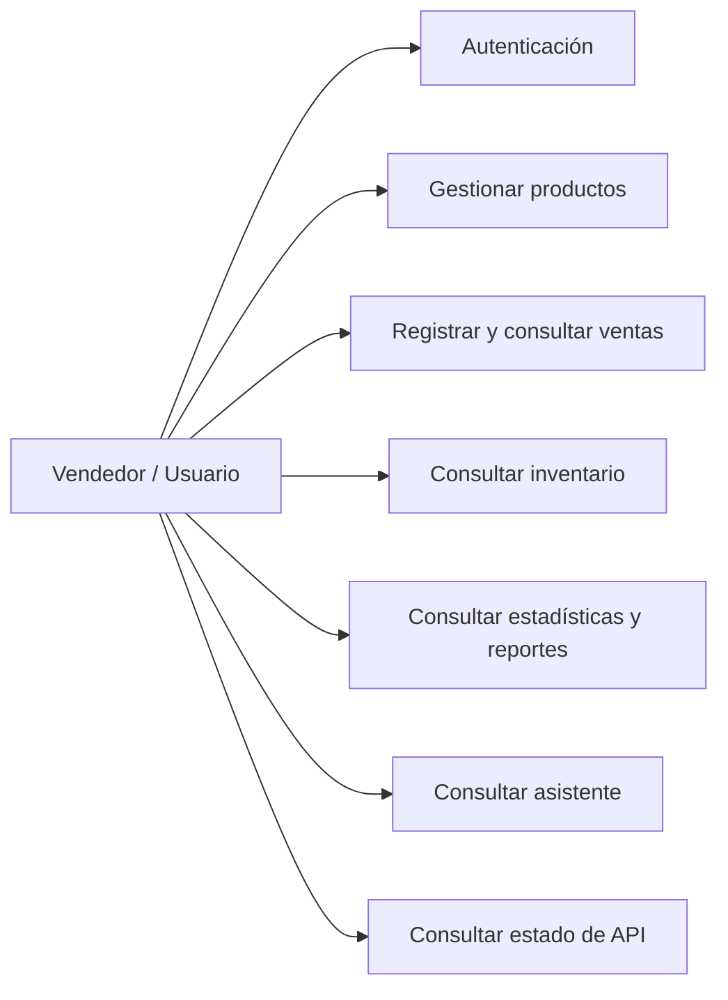
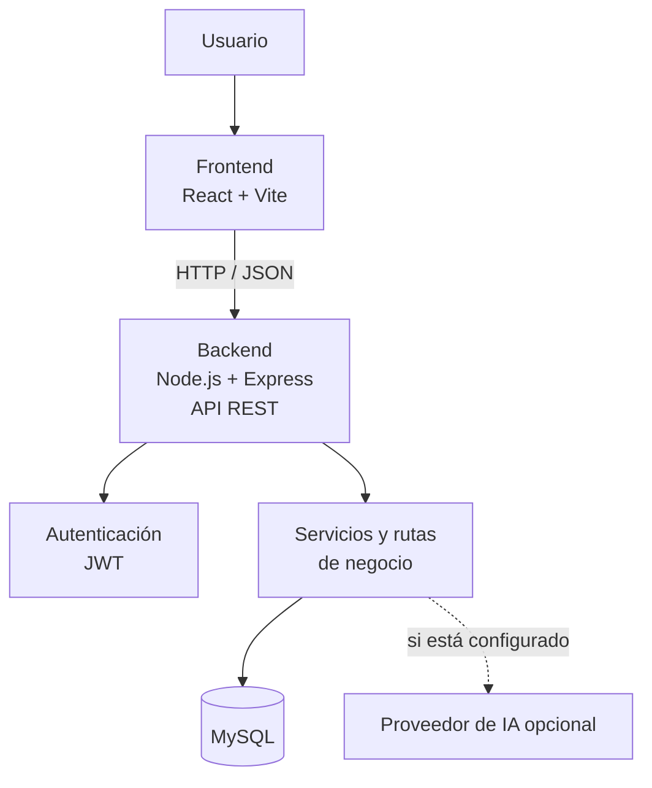
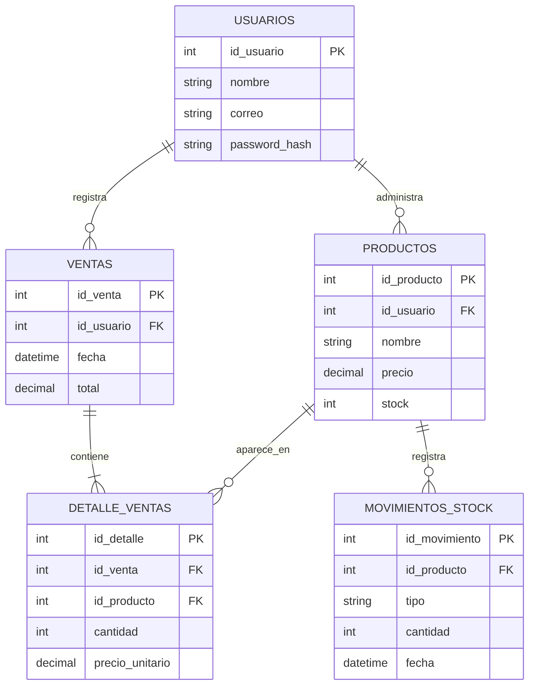

# Diagramas UML y arquitectura --- Vendix

**Proyecto APT · Ingeniería en Informática · Duoc UC, sede Valparaíso**\
Versión 1.0

Estos diagramas resumen el diseño conocido de Vendix a partir de la
descripción del proyecto y de los componentes identificados en el
backend. Son una base documental: antes de usarlos como representación
definitiva, comparar el diagrama entidad-relación con
`database/schema.sql` y revisar los nombres exactos de tablas, columnas
y relaciones. Los diagramas de casos de uso y arquitectura describen el
alcance previsto y no prueban por sí mismos que todas las funciones
estén integradas.

## 1. Diagrama de casos de uso (vista funcional)

**Lectura:** el usuario interactúa con las funciones de autenticación,
productos, ventas, inventario, reportes y asistente. La disponibilidad
real de cada caso de uso debe validarse en la aplicación integrada.

## 2. Diagrama de arquitectura (vista de componentes)

**Lectura:** el frontend React se comunica con la API REST Express
usando HTTP/JSON. El backend aplica autenticación y lógica de negocio y
consulta MySQL. La conexión con un proveedor de IA es opcional y depende
de la configuración.

## 3. Diagrama entidad-relación (modelo de datos)

**Importante:** los nombres de campos de este esquema son
representativos para explicar las relaciones previstas. Deben
confirmarse con `database/schema.sql` antes de entregar este diagrama
como modelo exacto de la base de datos. El backend ya contiene
`docs/er.mmd` y `docs/modelo-entidad-relacion.png`; si estos
corresponden al esquema vigente, conviene priorizarlos y no mantener dos
diagramas divergentes.

## 4. Archivos incluidos

-   `Diagramas_UML_Vendix.md`: los tres diagramas en Mermaid,
    renderizables en GitHub.
-   `casos_de_uso.mmd`: fuente del diagrama de casos de uso.
-   `arquitectura.mmd`: fuente del diagrama de arquitectura.
-   `modelo_datos_referencia.mmd`: modelo de datos de referencia,
    pendiente de cotejo con el esquema real.

## 5. Verificación antes de entregar

-   [ ] Confirmar los nombres exactos de tablas y columnas con
    `database/schema.sql`.
-   [ ] Revisar que la arquitectura coincida con los archivos y
    servicios actuales.
-   [ ] Confirmar qué módulos están conectados desde el frontend.
-   [ ] Sustituir cualquier relación o función que no corresponda al
    código vigente.
