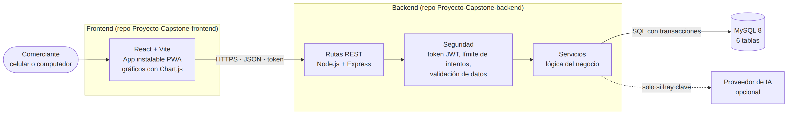

# Vendix — Frontend

**Aplicación web progresiva para la gestión de ventas e inventario de pequeños negocios.**  
Proyecto APT · Ingeniería en Informática · Duoc UC Valparaíso

<p align="center">
  <a href="https://vendixapp.online"><strong>🚀 Abrir Vendix en producción</strong></a>
</p>

<p align="center">
  
  
  
  
</p>


## Descripción

**Vendix** es una aplicación web de gestión de ventas e inventario orientada a vendedores ambulantes y pequeños negocios en Chile. Este repositorio contiene el frontend, es decir, la interfaz que utiliza el comerciante, diseñada para escritorio y dispositivos móviles y con capacidad de instalación como PWA.

Desde la aplicación se pueden administrar productos y categorías, controlar existencias, registrar y anular ventas, revisar indicadores y reportes, y consultar al asistente de IA sobre información del negocio.

## Funcionalidades

- Registro e inicio de sesión de usuarios.
- Gestión de productos, categorías, precios de compra y venta.
- Control de existencias, ajustes y alertas de stock bajo.
- Registro y anulación de ventas con actualización del inventario.
- Panel con indicadores y gráficos de ventas e inventario.
- Consejos y análisis del negocio.
- Asistente de IA para consultas en lenguaje natural sobre datos del negocio.
- Exportación de reportes a Excel y PDF.
- Diseño adaptable a móviles y computadores, con instalación PWA.

## Tecnologías

| Área | Tecnología |
|---|---|
| Interfaz | React 18, Vite 5 y CSS por componente |
| Gráficos | Chart.js 4 |
| Aplicación instalable | PWA, manifest y service worker |
| Comunicación | API REST y autenticación mediante JWT |
| Backend | Node.js y Express (repositorio separado) |
| Datos | MySQL compatible con TiDB Cloud |
| IA | Azure AI Foundry, modelo GPT-5-mini, integrada desde el backend |
| Hosting frontend | Netlify |

## Capturas de la aplicación

<p align="center">
  " alt="Vendix: interfaz principal" width="48%">
  " alt="Vendix: módulos de la aplicación" width="48%">
</p>

## Arquitectura



El frontend solicita los datos y operaciones al backend mediante `src/api/`. La API valida las solicitudes, aplica las reglas de negocio y accede a la base de datos. Las consultas del asistente de IA también se gestionan desde el backend; las credenciales del proveedor no se exponen al navegador.

Diagrama de componentes y otros diagramas UML: [Documentación de diagramas](Documentacion/Diagramas_UML_Vendix.md).  
Repositorio del backend: [Proyecto-Capstone-backend](https://github.com/danieldelta93/Proyecto-Capstone-backend).

## Ejecución local (paso a paso)

Requisitos: [Node.js](https://nodejs.org/) 18 o superior, npm y backend en ejecución.

```bash
# Clona el repositorio
git clone https://github.com/danieldelta93/Proyecto-Capstone-frontend.git
cd Proyecto-Capstone-frontend/Codigo

# Instala dependencias e inicia el servidor de desarrollo
npm install
npm run dev
```

Con el backend disponible en `http://localhost:3000`, abre `http://localhost:5173`. En desarrollo, Vite reenvía las solicitudes `/api` al backend local.


### Comandos disponibles

```bash
npm run dev       # servidor de desarrollo
npm run build     # genera la compilación de producción en dist/
npm run preview  # previsualiza la compilación local
```

Para la configuración de API en producción, consulta [`Codigo/.env.example`](Codigo/.env.example). La variable `VITE_API_URL` debe apuntar a la URL base de la API. No incluyas secretos en variables del frontend.

## Despliegue

- **Frontend:** Netlify
- **Dominio público:** [https://vendixapp.online](https://vendixapp.online)
- **Backend/API:** Render — [https://vendix-backend-k6te.onrender.com](https://vendix-backend-k6te.onrender.com)
- **Base de datos:** TiDB Cloud (servicio MySQL-compatible, conexión TLS desde backend)

## Equipo y roles


| Integrante | Rol principal |
|---|---|
| Esteban Guajardo | Frontend, diseño de interfaz (UX/UI) y pruebas de usabilidad |
| Daniel Troncoso | Líder técnico; backend, base de datos, asistente de IA y despliegue |

## Metodología

**Scrum**, organizado en sprints de dos semanas, con Product Backlog, Sprint Backlog, Definition of Done y retrospectivas. Se trabajó en la priorización de tareas, distribución de responsabilidades, revisión de avances e integración progresiva de funcionalidades.

Detalle: [`Documentacion/Metodologia_Scrum_Vendix.md`](Documentacion/Metodologia_Scrum_Vendix.md).

## Documentación

| Documento | Contenido |
|---|---|
| [Documento de inicio](Documentacion/Documento_Inicio_Proyecto_Vendix.md) | Objetivos, alcance MVP, restricciones, riesgos |
| [Visión del producto](Documentacion/Product_Vision_Vendix.md) · [Product Backlog](Documentacion/Product_Backlog_Vendix.md) · [Sprint Backlog](Documentacion/Sprint_Backlog_Vendix.md) | Artefactos Scrum |
| [Definition of Done](Documentacion/Definition_of_Done_Vendix.md) · [Retrospectivas](Documentacion/Retrospectivas_Vendix.md) | Criterios de calidad y mejora continua |
| [Requisitos no funcionales](Documentacion/Requisitos_No_Funcionales_Vendix.md) | Rendimiento, seguridad y usabilidad |
| [Diagramas UML](Documentacion/Diagramas_UML_Vendix.md) · [Plan de pruebas](Documentacion/Plan_Pruebas_Vendix.md) | Diseño y verificación |
| [Manual técnico](Documentacion/Manual_Tecnico_Vendix.md) · [Innovación](Documentacion/Innovacion_Vendix.md) | Operación, instalación y propuesta de valor |

## Estructura del repositorio

```text
Codigo/             aplicación (src/, public/, package.json)
Documentacion/      documentación Markdown/Word e imágenes de diagramas
FASE 1/ FASE 2/ FASE 3/ evidencias y entregables del curso
```

## Estado del proyecto

Vendix se encuentra desplegado y disponible en su dominio público. El frontend se comunica con el backend publicado, que utiliza TiDB Cloud para persistencia y Azure AI Foundry para el asistente. La documentación y las evidencias de las fases del proyecto se mantienen en este repositorio.
