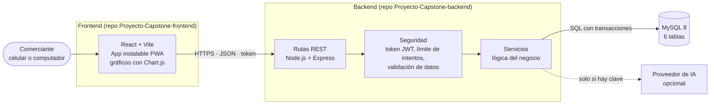

# Vendix — Frontend (aplicación web instalable)

**Proyecto APT (Capstone) · Ingeniería en Informática · Duoc UC Valparaíso**

## Descripción

**Vendix** es un sistema de gestión de ventas e inventario para **vendedores ambulantes y pequeños negocios** en Chile. Este repositorio contiene el
**frontend**: la aplicación que usa el comerciante, pensada para el celular y **instalable** como una app (PWA). Permite crear una cuenta, administrar
productos con su precio de compra y de venta, registrar y anular ventas, ver el panel con la inversión y la ganancia, preguntarle al asistente y exportar reportes.

El backend (API y base de datos) está en [Proyecto-Capstone-backend](https://github.com/danieldelta93/Proyecto-Capstone-backend).

## Tecnologías

| Parte | Tecnología |
|---|---|
| Interfaz | React 18 + Vite 5, CSS propio por componente |
| Gráficos | Chart.js 4 |
| App instalable | PWA (manifest y service worker) |
| Comunicación | API REST con el backend (token JWT) |
| Backend (otro repo) | Node.js, Express, MySQL |

## Arquitectura



La app (`src/components/`) pide y guarda todo en el backend a través de `src/api/`. Las contraseñas nunca quedan en el navegador: solo un token de sesión.
Diagrama de componentes y demás diagramas UML: [`Documentacion/Diagramas_UML_Vendix.md`](Documentacion/Diagramas_UML_Vendix.md).

## Ejecución local (paso a paso)

Necesitas [Node.js](https://nodejs.org/) 18 o superior y **el backend encendido** (ver el README del repositorio del backend).

```bash
# 1. Enciende el backend (en otra terminal):  http://localhost:3000/api/salud debe responder
# 2. Descarga e inicia el frontend
git clone https://github.com/danieldelta93/Proyecto-Capstone-frontend.git
cd Proyecto-Capstone-frontend/Codigo
npm install
npm run dev
# 3. Abre http://localhost:5173, crea tu cuenta y empieza a usarla
```

En desarrollo, Vite reenvía las llamadas `/api` a `http://localhost:3000`, así que no hay que configurar nada más.
Para publicar la app se define `VITE_API_URL` (ver `Codigo/.env.example`) y se ejecuta `npm run build`.
Instalación en el celular, publicación y solución de problemas: [`Documentacion/Manual_Tecnico_Vendix.md`](Documentacion/Manual_Tecnico_Vendix.md).

## Equipo y roles

| Integrante | Rol |
|---|---|
| Esteban Guajardo | Frontend, diseño de interfaz (UX/UI) y pruebas de usabilidad |
| Daniel Troncoso | Líder técnico; backend, base de datos, asistente de IA y despliegue |

Kevin Godoy participó en la Fase 1 (backend y base de datos) y dejó el equipo durante la Fase 2.

## Metodología

**Scrum**, en sprints de dos semanas: los requerimientos de usuarios no técnicos se descubren probando el producto, el equipo es pequeño y cada fase del
curso pide un avance que funcione. Artefactos: Product Backlog, Sprint Backlog, Definition of Done y retrospectivas.
Detalle y justificación: [`Documentacion/Metodologia_Scrum_Vendix.md`](Documentacion/Metodologia_Scrum_Vendix.md).

## Documentación

| Documento | |
|---|---|
| [Documento de inicio](Documentacion/Documento_Inicio_Proyecto_Vendix.md) | Objetivos, alcance MVP, restricciones, riesgos |
| [Visión del producto](Documentacion/Product_Vision_Vendix.md) · [Product Backlog](Documentacion/Product_Backlog_Vendix.md) · [Sprint Backlog](Documentacion/Sprint_Backlog_Vendix.md) | Artefactos Scrum |
| [Definition of Done](Documentacion/Definition_of_Done_Vendix.md) · [Retrospectivas](Documentacion/Retrospectivas_Vendix.md) | Calidad y mejora continua |
| [Requisitos no funcionales](Documentacion/Requisitos_No_Funcionales_Vendix.md) | Rendimiento, seguridad, usabilidad |
| [Diagramas UML](Documentacion/Diagramas_UML_Vendix.md) · [Plan de pruebas](Documentacion/Plan_Pruebas_Vendix.md) | Diseño y pruebas |
| [Manual técnico](Documentacion/Manual_Tecnico_Vendix.md) · [Innovación](Documentacion/Innovacion_Vendix.md) | |

## Estructura del repositorio

```
Codigo/            la aplicación (src/, public/, package.json)
Documentacion/     documentos del proyecto (Markdown y Word) e imágenes de los diagramas
FASE 1/ FASE 2/ FASE 3/   evidencias de cada fase del curso
```

## Estado del proyecto

Aplicación funcionando y conectada al backend. Pendientes: publicación en internet, pantallas de reposición de stock y de "menos vendidos", y pruebas de
usabilidad con comerciantes reales. Ver [Sprint Backlog](Documentacion/Sprint_Backlog_Vendix.md).
